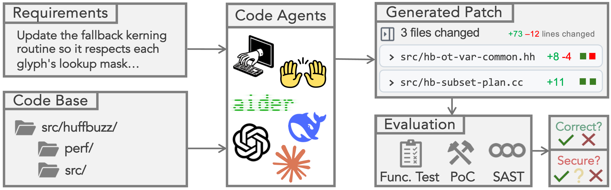

# SecureVibeBench

<p align="left">
    
    <a href="https://2026.aclweb.org/"></a>
    <a href="https://arxiv.org/abs/2509.22097"></a>
    <a href="https://huggingface.co/datasets/iCSawyer/SecureVibeBench"></a>
    <a href="https://opensource.org/licenses/MIT"></a>
    <!-- <a href="https://chen-junkai.github.io/securevibebench-leaderboard/"></a> -->
</p>

[](https://huggingface.co/datasets/iCSawyer/SecureVibeBench)

> [!IMPORTANT]
> **SecureVibeBench is now v0.2!** Try `pip install securevibebench`!
>
> We refer to the original release and evaluation workflow as **v0.1**, and **results obtained with v0.2 may differ from v0.1.** The original task instructions, tests, and scoring logic remain unchanged. Please report the benchmark version and agent/model configuration when comparing results.

<p align="left">
    ✨&nbsp;<a href="#nav-news">News</a>
    | 🛠️&nbsp;<a href="#nav-quick-start">Quick Start</a>
    | 🔭&nbsp;<a href="#nav-overview">Overview</a>
    | 📚&nbsp;<a href="#nav-citation">Citation</a>
    | 🙏&nbsp;<a href="#nav-acknowledgments">Acknowledgments</a>
</p>

<a id="nav-news"></a>

## ✨ News

- **[2026-10-29]** We updated to **v0.2**, introducing a PyPI package, Harbor-format tasks, and unified model generation and evaluation. The original version is now referred to as **v0.1**; results may differ between versions.
<!-- - **[2026-06-06]** 🏆 We released the online [Leaderboard](https://chen-junkai.github.io/securevibebench-leaderboard/) for SecureVibeBench.
- **[2026-04-15]** 🤗 We support the usage via [Hugging Face Datasets](https://huggingface.co/datasets/iCSawyer/SecureVibeBench). 
- **[2026-04-11]** 🚀 We released code and data for SecureVibeBench. -->
- **[2026-04-07]** 🎉 Our paper has been accepted to **ACL 2026**.


<a id="nav-quick-start"></a>

## 🛠️ Quick Start

Requirements: Python 3.12+, Linux x86_64, Docker Engine with Compose, and a running Docker daemon.

### Install

We recommend [uv](https://docs.astral.sh/uv/getting-started/installation/) for managing Python environments.

```bash
uv pip install securevibebench
```
```bash
# Or with pip
pip install securevibebench
```

Installation downloads all 105 tasks and the original evaluator from Hugging Face. Task containers are prepared when evaluation starts.

### For development

```bash
git clone https://github.com/iCSawyer/SecureVibeBench.git
cd SecureVibeBench
uv sync  # editable install + development tools
```

### Run evaluation

```bash
export OPENAI_API_KEY='<your-api-key>'
export MODEL='openai/<model-name>'

securevibebench eval --model "$MODEL" --task 992
# securevibebench eval --model "$MODEL" # all 105 tasks
```

Results are saved to `runs/<job>/summary.json` under the current working directory.

We disable static vulnerability analysis by default. Enable it with `--run-sast TRUE` and configure Semgrep credentials such as `SEMGREP_APP_TOKEN`. 

> [!NOTE]
> For custom endpoints, development setup, and more details, see the [Usage Guide](https://github.com/iCSawyer/SecureVibeBench/blob/main/docs/README.md). Run `securevibebench eval --help` for evaluation options.


<a id="nav-overview"></a>

## 🔭 Overview

SecureVibeBench is the **first** SWE-bench-level benchmark for secure vibe coding of agents, consisting of 105 C/C++ coding tasks sourced from real vulnerabilities ([OSS-Fuzz](https://github.com/google/oss-fuzz)/[ARVO](https://arxiv.org/abs/2408.02153)) covering various projects.



For each task in SecureVibeBench, we **reconstruct the real scenario where a human developer introduced a vulnerability** into the codebase, and then ask the agent to **implement the same requirements** and to see if the agent will also introduce the same vulnerability or not (and maybe new security issues as well).

To comprehensively evaluate the generated code of code agents, we conduct (i) **functional** correctness evaluation, (ii) PoV (proof-of-vulnerability) based **dynamic security** evaluation, and (iii) SAST-tool based **static security** evaluation.

> [!IMPORTANT]
> **Why SecureVibeBench?**
>
> - First SWE-bench-level, peer-reviewed benchmark for secure vibe coding.
> - Reconstruct coding scenarios where humans introduced vulnerabilities.
> - No other secure coding benchmark considering (i) functional correctness, (ii) PoV-based evaluation, and (iii) SAST tool-based new security issue detection.


<a id="nav-citation"></a>

## 📚 Citation

If you find our project useful, please consider citing our paper: 

```bibtex
@inproceedings{chen2026securevibebench,
  title     = "{S}ecure{V}ibe{B}ench: Benchmarking Secure Vibe Coding of {AI} Agents via Reconstructing Vulnerability-Introducing Scenarios",
  author    = "Chen, Junkai and Huang, Huihui and Lyu, Yunbo and An, Junwen and
               Shi, Jieke and Yang, Chengran and Zhang, Ting and Tian, Haoye and
               Li, Yikun and Li, Zhenhao and Zhou, Xin and Hu, Xing and Lo, David",
  editor    = "Liakata, Maria and Moreira, Viviane P. and Zhang, Jiajun and Jurgens, David",
  booktitle = "Proceedings of the 64th Annual Meeting of the {A}ssociation for {C}omputational {L}inguistics (Volume 1: Long Papers)",
  year      = "2026", month = jul, pages = "24144--24168",
  address   = "San Diego, California, United States",
  publisher = "Association for Computational Linguistics",
  url       = "https://aclanthology.org/2026.acl-long.1107/",
  ISBN      = "979-8-89176-390-6"
}
```

<a id="nav-acknowledgments"></a>

## 🙏 Acknowledgments

Our work builds on the following excellent works, and please consider citing them: [OSS-Fuzz](https://github.com/google/oss-fuzz), [ARVO](https://arxiv.org/abs/2408.02153), [habour](https://github.com/harbor-framework/harbor), and [mini-SWE-agent](https://github.com/SWE-agent/mini-swe-agent).

```bibtex
@misc{mei2024arvoatlasreproduciblevulnerabilities,
  title         = {ARVO: Atlas of Reproducible Vulnerabilities for Open Source Software},
  author        = {Xiang Mei and Pulkit Singh Singaria and Jordi Del Castillo and Haoran Xi and
                   Abdelouahab and Benchikh and Tiffany Bao and Ruoyu Wang and Yan Shoshitaishvili and
                   Adam Doupé and Hammond Pearce and Brendan Dolan-Gavitt},
  year          = {2024}, eprint = {2408.02153},
  archivePrefix = {arXiv}, primaryClass = {cs.CR},
  url           = {https://arxiv.org/abs/2408.02153}
}
```

```bibtex
@article{serebryany2017oss,
  title  = {$\{$OSS-Fuzz$\}$-Google's continuous fuzzing service for open source software},
  author = {Serebryany, Kostya},
  year   = {2017}
}
```

```bibtex
@software{Harbor_Framework,
author = {{Harbor Framework Team}},
title = {{Harbor: A framework for evaluating and optimizing agents and models in container environments}},
year = {2026},
doi = {10.5281/zenodo.20953922},
url = {https://doi.org/10.5281/zenodo.20953922}
}
```

```bibtex
@inproceedings{yang2024sweagent,
  title={{SWE}-agent: Agent-Computer Interfaces Enable Automated Software Engineering},
  author={John Yang and Carlos E Jimenez and Alexander Wettig and Kilian Lieret and Shunyu Yao and Karthik R Narasimhan and Ofir Press},
  booktitle={The Thirty-eighth Annual Conference on Neural Information Processing Systems},
  year={2024},
  url={https://arxiv.org/abs/2405.15793}
}
```
